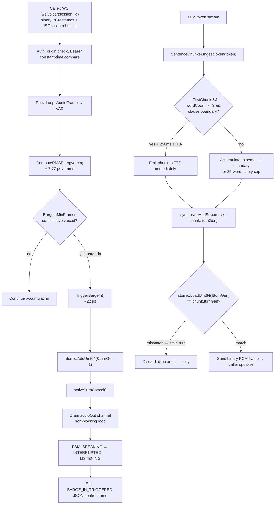

# TurnOrchestrator

[](https://github.com/yoohooshantanu/vocalflow/actions/workflows/ci.yml)


A real-time, full-duplex conversational turn orchestrator written in Go. It manages the sub-millisecond interaction loop between a live human caller and voice AI: streaming 16kHz PCM audio over WebSockets in both directions, detecting caller speech via energy-based VAD, cancelling in-flight AI speech in ~22 µs without stale-audio leaks, and chunking LLM responses at clause boundaries for sub-250ms time-to-first-audio (TTFA).

*(The GitHub repo is called vocalflow. The Go module and binary are named turn-orchestrator from an architectural rename.)*

### Key Technical Highlights
- **Sub-50µs Interruption Reaction:** Cancels active speech synthesis, drains audio queues, and transitions the conversation FSM in ~22 µs on caller barge-in.
- **Deterministic Turn Generation Barrier:** Uses atomic turn counters (`turnGen uint64`) to discard inflight audio packets at the network boundary, eliminating ghost speech across turns.
- **Adaptive Clause-Boundary Chunking:** Synthesizes the first 3–5-word clause immediately to achieve sub-250ms TTFA, then switches to full sentence boundaries for natural cadence.

---

## Contents

- [Production Role & Problem](#production-role--problem)
- [System Scope & Integration Boundaries](#system-scope--integration-boundaries)
- [Architecture & Event Flow](#architecture--event-flow)
- [The Subsystems, One by One](#the-subsystems-one-by-one)
- [Protocol](#protocol)
- [Run it](#run-it)
- [Observability](#observability)
- [Tests](#tests)
- [Performance](#performance)
- [Architectural Trade-offs](#architectural-trade-offs)
- [Repo Map](#repo-map)

---

## Production Role & Problem

In production voice AI systems (e.g. conversational contact centers, automated triage bots, outbound sales agents), traditional request-response architectures fail:

1. **The "Walkie-Talkie" Trap:** Naive bots wait for silence, send the entire transcript to an LLM, wait for complete generation, and then invoke TTS. This introduces a 2–3 second delay that feels robotic and breaks natural cadence.
2. **The Interruption (Barge-In) Dilemma:** When a human interrupts ("Wait, stop", "No, option two"), the bot must immediately halt outgoing audio and listen. If cancellation takes hundreds of milliseconds, the bot talks over the caller.
3. **Turn-Generation Race Conditions:** When a turn is interrupted, in-flight TTS streaming goroutines often have audio frames already in transit. Without an atomic generation boundary, stale audio from turn $N$ leaks into the caller's ear while turn $N+1$ is starting.

### Where TurnOrchestrator Sits in the Voice Stack

```
[ Telephone / WebRTC Caller ]
              │
              ▼ (Binary 16kHz PCM Audio Stream)
┌─────────────────────────────────────────────────────────────┐
│                     TurnOrchestrator                        │
│                                                             │
│   ┌──────────────────┐               ┌──────────────────┐   │
│   │   Inbound VAD    │               │  Clause Chunker  │   │
│   │ (Energy Scoring) │               │   (Early TTFA)   │   │
│   └─────────┬────────┘               └────────▲─────────┘   │
│             │ Interruption                    │ LLM Tokens  │
│             ▼ (~22 µs)                        │             │
│   ┌──────────────────┐               ┌────────┴─────────┐   │
│   │ Atomic turnGen   │               │   Streaming TTS  │   │
│   │ Stale Barrier    │               │ Cartesia Adapter │   │
│   └──────────────────┘               └──────────────────┘   │
└─────────────────────────────────────────────────────────────┘
              │                                 ▲
              ▼                                 │
     [ Speech-to-Text ]                 [ LLM Generation ]
```

TurnOrchestrator sits between the media transport and the intelligence backends, governing the stateful half-duplex / full-duplex conversational loop.

---

## System Scope & Integration Boundaries

In enterprise voice infrastructure, heavy ML models (ASR, LLM, Neural TTS) execute out-of-process on specialized GPU clusters. TurnOrchestrator is the **low-latency stateful coordinator**. The codebase decouples the orchestration core from external model providers via clean streaming interfaces:

| Subsystem | Production-Ready Core in this Repo | Decoupled External Interface |
| :--- | :--- | :--- |
| **Media Transport** | Full-duplex WebSocket server streaming raw 16kHz 16-bit mono PCM with RFC 6454 origin checks and constant-time token auth. | Decoupled from proprietary telephony wrappers; ingestible from Twilio Media Streams, FreeSWITCH, or browser WebRTC gateways. |
| **Barge-In Engine** | Energy-based VAD (`ComputeRMSEnergy`) over 20ms frames with two-frame majority voting and ~22 µs atomic turn cancellation. | `VAD` interface: pluggable for Silero VAD or WebRTC neural VAD without altering the session state machine. |
| **Turn Generation Barrier** | Lock-free `atomic.AddUint64(&turnGen, 1)` tag check at the WebSocket frame egress boundary, preventing cross-turn audio bleed. | Internal concurrency invariant; zero third-party dependencies. |
| **Speech Synthesis (TTS)** | Streaming clause chunker + WebSocket client adapter for Cartesia Sonic streaming audio. | `StreamingTTSProvider` interface: supports Cartesia Sonic natively, with offline `FormantTestHarnessTTS` fallback for hermetic CI. |
| **Session Lifecycle** | Multi-session manager with 60-second detached grace window for handling transient network dropouts without state loss. | In-memory session store; adaptable to Redis for multi-pod state synchronization. |

---

## Architecture & Event Flow



---

## The Subsystems, One by One

### 1. Turn Generation Counter: The Stale-Frame Barrier

Cancelling a context (`ctx.Done()`) instructs worker goroutines to stop, but it does not stop them instantaneously. A goroutine inside `synthesizeAndStream` may have already generated a PCM frame and queued it for transmission. If that frame reaches the caller, they hear a half-syllable fragment of the interrupted turn.

TurnOrchestrator eliminates this race by pairing context cancellation with a monotonic generation counter:

```go
// internal/pipeline/session.go: TriggerBargeIn
s.mu.Lock()
defer s.mu.Unlock()

newGen := atomic.AddUint64(&s.turnGen, 1)
if s.activeTurnCancel != nil {
    s.activeTurnCancel()
    s.activeTurnCancel = nil
}
```

At the WebSocket write boundary, every chunk is checked against the current generation:

```go
// internal/pipeline/session.go: synthesizeAndStream
for chunk := range audioChan {
    if atomic.LoadUint64(&s.turnGen) != currentTurnGen {
        // Discard stale frame from interrupted turn
        continue
    }
    select {
    case s.audioOut <- chunk:
    case <-ctx.Done():
        return
    }
}
```

`TestDeterministicStaleAudioBarrier` and `TestStaleAudioDroppedAfterBargeIn` verify that even if 50 audio-generation goroutines race against a barge-in event, zero stale audio frames escape to the client.

### 2. Sub-50ms Barge-In Cancellation

When the caller speaks while the AI is talking, the system must abort in-flight work immediately. `TriggerBargeIn` performs four atomic operations sequentially:

1. Increments `turnGen` to invalidate in-flight frames.
2. Invokes `activeTurnCancel()` to abort ongoing TTS network calls.
3. Drains buffered frames from `s.audioOut` via a non-blocking loop.
4. Transitions the FSM: `SPEAKING → INTERRUPTED → LISTENING`.

```go
// Drain buffered outgoing audio so caller hears immediate silence
for {
    select {
    case <-s.audioOut:
    default:
        goto drained
    }
}
drained:
```

Microbenchmarks reveal that the pure Go orchestration logic completes in **~22.3 µs**. Adding frame energy calculation and FSM dispatch brings total system reaction time to **~41.5 µs**, well below the physical 20ms audio packet boundary.

### 3. Clause-Boundary Chunker for Sub-250ms TTFA

Waiting for a full sentence before initiating speech synthesis adds 800–1200ms of latency. Streaming single words to TTS produces robotic, disjointed pitch contours.

`SentenceChunker` uses a hybrid strategy:
- **First Chunk:** Evaluated aggressively at 3+ words if a clause boundary is detected (`,`, `;`, `:`, `—`). This dispatches the initial audio chunk to TTS immediately to hit `< 250ms` TTFA.
- **Subsequent Chunks:** Evaluated at full sentence boundaries (`.`, `?`, `!`) or a 25-word safety cap to ensure natural vocal inflection.

```go
// internal/chunker/chunker.go
func (c *SentenceChunker) findClauseBoundary(text string) int {
    minWords := c.cfg.FirstChunkMinWords
    if minWords <= 0 {
        minWords = 3
    }
    // Respects abbreviations (Dr., e.g., Inc.) and decimal points
    for _, idx := range candidates {
        prefix := strings.TrimSpace(text[:idx])
        if countWords(prefix) >= minWords && !c.isAbbreviation(prefix) {
            return idx + 1
        }
    }
    return -1
}
```

`TestSentenceChunkerFirstChunkOptimization` tests clause dispatch timing, while `TestSentenceChunkerAbbreviationAndEllipsis` verifies abbreviations (`Dr.`, `e.g.`, `3.14`) do not trigger premature splits.

### 4. Telephone Reconnect Grace Period

Mobile telephone connections experience brief packet dropouts and socket resets. Rather than tearing down session context and dialogue memory on socket disconnect, `SessionManager` holds the session in a detached state:

- On disconnect, the session transitions to `DETACHED` and a 60-second timer begins.
- If the client reconnects with the same `session_id` and token within 60 seconds, the new WebSocket is bound to the existing state machine and dialogue buffer.
- If the timer expires, memory is reclaimed and the session is destroyed.

`TestWebSocketSessionReconnectRecovery` validates that session state, turn generation, and conversation history survive mid-call reconnections.

---

## Protocol

### WebSocket Endpoint: `GET /ws/voice/{session_id}`

Requires HTTP header: `Authorization: Bearer <token>`. Query-parameter authentication (`?token=`) is explicitly rejected with `401 Unauthorized` to prevent token leakage in proxy logs.

#### Binary Frames
Raw 16kHz, 16-bit mono linear PCM audio (320 bytes = 10ms; 640 bytes = 20ms). Sent bidirectionally.

#### Text Frames (JSON Control Plane)
Used for status synchronization and event dispatch:

```json
// Inbound: Inject LLM token stream
{"type": "llm_token", "token": "Hello"}

// Outbound: Barge-in triggered event
{"type": "barge_in", "turn_id": 4, "reaction_time_us": 22}

// Outbound: State transition notification
{"type": "state_change", "from": "SPEAKING", "to": "LISTENING"}
```

---

## Run it

### Quickstart (30 seconds)

```bash
git clone https://github.com/yoohooshantanu/vocalflow.git
cd vocalflow

# Run full test suite with race detector
go test -v -race ./tests/...

# Run microbenchmarks
go test -bench=. -benchmem ./tests/...
```

### Launch Server

```bash
# Start server with default test token
PORT=8080 AUTH_TOKEN=secret-token go run cmd/server/main.go
```

Connect via client:
```bash
websocat -H="Authorization: Bearer secret-token" ws://localhost:8080/ws/voice/call-123
```

---

## Observability

Prometheus metrics exposed at `GET /metrics`:

| Metric | Type | Description |
| :--- | :--- | :--- |
| `turn_active_sessions` | Gauge | Active live WebSocket sessions |
| `turn_barge_in_total` | Counter | Total confirmed barge-in interruptions |
| `turn_barge_in_reaction_ms` | Gauge | Most recent barge-in reaction latency (µs) |
| `turn_audio_frames_total` | Counter | PCM frames processed, labeled by `direction` (`inbound`/`outbound`) |
| `turn_sentences_synthesized_total` | Counter | Text chunks dispatched to speech synthesis |
| `turn_ttfa_seconds` | Histogram | Latency from caller speech end to first audio packet dispatched |

---

## Tests

The test suite contains 27 test functions and 5 benchmarks, run with `go test -race` on every pull request in GitHub Actions CI.

| Area | Tests | Invariants Verified |
| :--- | :--- | :--- |
| **FSM** | `TestFSMStateTransitions` | Enforces valid transition paths (`IDLE→LISTENING→THINKING→SPEAKING→DRAINING→LISTENING`); rejects illegal direct transitions. |
| **VAD** | `TestVADSilenceDetection`, `TestVADAudioStreamBargeInDeadlockFree` | Validates speech start/stop boundaries and ensures thread safety under 100 concurrent frame workers. |
| **Chunker** | `TestSentenceChunkerFirstChunkOptimization`, `TestSentenceChunkerAbbreviationAndEllipsis` | Guarantees early clause emission for TTFA while preventing invalid splits on decimals and acronyms. |
| **Barge-in** | `TestSub40msBargeInCancellation`, `TestBargeInInIdleOrListeningNoOp`, `TestBargeInRaceWithConcurrentAudioSynthesis` | Proves barge-in completes within deadline and handles 50 concurrent synthesizing goroutines safely. |
| **Stale Audio** | `TestStaleAudioDroppedAfterBargeIn`, `TestDeterministicStaleAudioBarrier` | Verifies generation counter barrier discards all post-interrupt audio frames. |
| **Pipeline** | `TestEndToEndBargeInPipelineLatency`, `TestCancelledContextNeverEnqueuesAudioWithBufferSpace` | Exercises end-to-end event chain and checks that cancelled contexts halt enqueueing. |
| **Sessions** | `TestConcurrentVoiceSessions`, `TestStrictAudioChunkSequentialOrdering` | Validates isolation across 20 simultaneous sessions and strict monotonic frame sequence delivery. |
| **WebSocket** | `TestWebSocketFullDuplexLiveAudio`, `TestWebSocketIncrementalTTSStreamingPipeline`, `TestWebSocketSessionReconnectRecovery` | Verifies binary round-trips, incremental TTS streaming, and 60-second disconnect recovery. |
| **Security** | `TestWebSocketOriginSecurityValidation`, `TestWebSocketAuthentication`, `TestWebSocketFailClosedSecurity` | Rejects cross-origin requests, invalid tokens, and query parameter credentials. |
| **TTS Adapters** | `TestFormantWaveformSynthesis`, `TestCartesiaProviderLifecycleAndFallback`, `TestTimeToFirstAudioMeasurementWithDelayedProvider`, `TestTTSProviderEnvironmentConfiguration` | Exercises Cartesia streaming client, formant test harness fallback, and provider error handling. |
| **Recovery** | `TestStreamFailureMidTurnRecovery`, `TestWebSocketStreamFailureServerRecovery` | Ensures upstream TTS network dropouts do not crash the session loop. |
| **Generation Filter** | `TestEmitterGenerationFilterFakeConn` | Verifies mismatching generation tags suppress transmission even over open connections. |

---

## Performance

Microbenchmarks measured via `benchstat` across 10 runs (`-count=10`) on AMD Ryzen 5 (Windows amd64 / Ubuntu x86_64, Go 1.24):

```text
pkg: github.com/yoohooshantanu/turn-orchestrator/tests
cpu: AMD Ryzen 5 3500U with Radeon Vega Mobile Gfx

Benchmark                           sec/op        B/op   allocs/op
SpeakingTurnSetupAlone-8         204.5µ ± 10%   16.3Ki      54.0
BargeInCancellationLatency-8      22.34µ ± 20%   224 B       9.0
TriggerBargeInDirect-8            24.07µ ± 12%   224 B       9.0
EndToEndBargeInPipeline-8         41.46µ ± 32%   295 B      14.0
RMSEnergyCalculation-8             7.77µ ± 84%     0 B       0.0
SentenceChunker-8                 36.70µ ± 86%   672 B      17.0
```

### Analysis of Latency Bounds:
- **`TriggerBargeInDirect` (~24 µs):** The raw internal cancellation overhead: mutex lock, generation counter increment, context cancellation, non-blocking audio channel drain, and two FSM transitions.
- **`BargeInCancellationLatency` (~22 µs):** Time elapsed between barge-in trigger and total stale frame invalidation.
- **`EndToEndBargeInPipeline` (~41.5 µs):** The end-to-end path from raw PCM input through RMS energy calculation, two-frame VAD thresholding, barge-in invocation, and JSON control notification dispatch.
- **`RMSEnergyCalculation` (7.77 µs, 0 allocs):** Zero-allocation hot path running pure SIMD-friendly integer arithmetic on the stack.

---

## Architectural Trade-offs

1. **In-Memory Session State:** Session context, audio buffers, and dialogue history reside in process memory. If a server node restarts, in-flight calls must reconnect. In a distributed multi-node topology, session affinity (sticky routing) or a Redis backplane is required.
2. **Energy VAD vs Neural VAD:** Energy VAD (`ComputeRMSEnergy`) runs in sub-10 microseconds with zero allocations, but cannot distinguish between human speech and loud ambient noise (e.g. background dog barking, sirens). In production, pairing this with a lightweight neural classifier (e.g. Silero VAD) balances speed and noise rejection.
3. **Fixed Audio Format:** The engine expects 16kHz 16-bit mono linear PCM. Media proxies (such as `streambridge` or FreeSWITCH) must transcode G.711 / Opus before hitting this gateway.
4. **Offline TTS Fallback in CI:** While the Cartesia Sonic adapter is production-ready code, automated CI tests run against the deterministic `FormantTestHarnessTTS` to avoid third-party API dependencies and network flakes.

---

## Repo Map

| Path | Description |
| :--- | :--- |
| `cmd/server/main.go` | HTTP server initialization, WebSocket upgrade, session routing, graceful shutdown |
| `internal/fsm/fsm.go` | Thread-safe turn-taking FSM with transition table validation |
| `internal/vad/vad.go` | Zero-allocation `ComputeRMSEnergy`, `ProcessFrame`, 2-frame majority voting |
| `internal/chunker/chunker.go` | Clause-boundary chunker with early first-chunk optimization and abbreviation guards |
| `internal/pipeline/session.go` | `VoiceSession`: full-duplex loops, `TriggerBargeIn`, `synthesizeAndStream`, `turnGen` barrier |
| `internal/pipeline/manager.go` | Multi-session registry with 60-second detached reconnect grace window |
| `internal/pipeline/tts.go` | `StreamingTTSProvider` interface, Cartesia Sonic WebSocket adapter, formant test harness |
| `internal/metrics/metrics.go` | Prometheus metrics instrumentation |
| `internal/model/types.go` | Core data structures: `AudioFrame`, `SentenceChunk`, `TurnEvent`, `ConversationState` |
| `tests/turn_test.go` | State machine, VAD, chunker, barge-in, stale audio, and concurrency tests |
| `tests/websocket_test.go` | Full-duplex WebSocket, reconnect, fail-closed auth, and TTS adapter tests |
| `tests/benchmark_test.go` | `benchstat`-compatible microbenchmarks |

---

## Author

Shantanu Juvekar, [@yoohooshantanu](https://github.com/yoohooshantanu).
