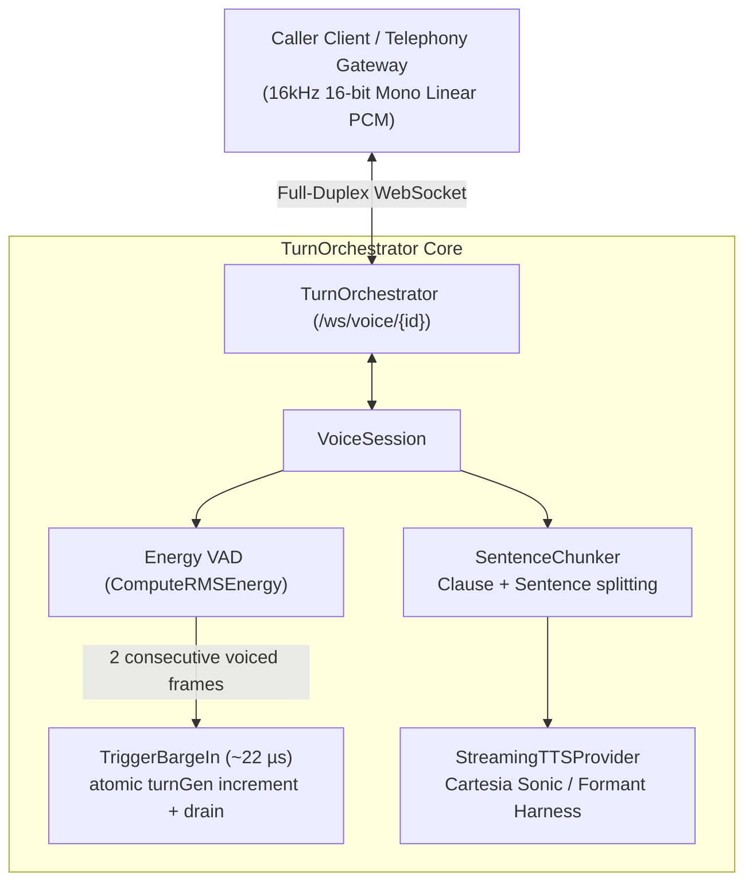
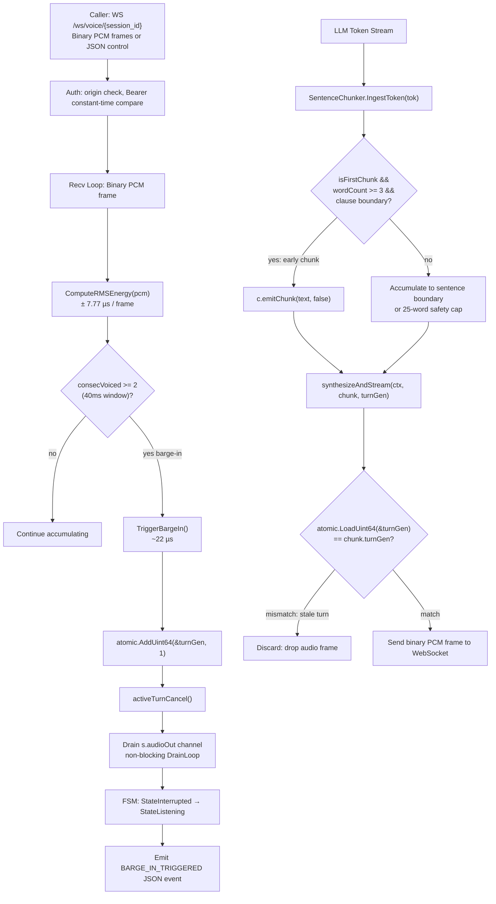

# TurnOrchestrator

[](https://github.com/yoohooshantanu/vocalflow/actions/workflows/ci.yml)


A real-time, full-duplex conversational turn orchestrator written in Go. It manages the conversational loop between a caller and voice AI: streaming 16kHz PCM audio over WebSockets in both directions, detecting caller speech via energy-based VAD, cancelling in-flight AI speech in ~22 µs on caller barge-in, and chunking streaming LLM tokens at clause boundaries.

*(The GitHub repo is called vocalflow. The Go module and binary are named turn-orchestrator from an architectural rename.)*

### Key Technical Highlights
- **Sub-50µs Interruption Reaction:** Cancels active speech synthesis, drains audio queues, and transitions the conversation FSM in ~22 µs upon user barge-in.
- **Deterministic Turn Generation Barrier:** Uses atomic turn counters (`turnGen uint64`) to discard inflight audio packets at the network boundary, eliminating ghost speech across turns.
- **Clause-Boundary Token Chunking:** Splits streaming LLM tokens at clause boundaries (comma, semicolon, colon) after 3+ words for early audio dispatch, switching to sentence boundaries for subsequent speech.

---

## Contents

- [The Idea and Problem](#the-idea-and-problem)
- [What is Real and What is Mocked](#what-is-real-and-what-is-mocked)
- [Architecture & Event Flow](#architecture--event-flow)
- [The Subsystems, One by One](#the-subsystems-one-by-one)
- [Protocol](#protocol)
- [Run it](#run-it)
- [Observability](#observability)
- [Tests](#tests)
- [Performance](#performance)
- [Limitations and Rough Edges](#limitations-and-rough-edges)
- [Repo Map](#repo-map)

---

## The Idea and Problem

Most voice AI demos work like a walkie-talkie: you speak a full sentence, the machine waits for silence, runs generation, and plays audio back. If the user interrupts mid-sentence, three distinct failure modes emerge in concurrent systems:

1. **Sluggish Interruption:** If cancellation takes hundreds of milliseconds, the bot continues talking over the human.
2. **Turn-Generation Race Conditions:** When an interrupt fires, goroutines already streaming TTS frames may still have packets in transit. Without an atomic generation boundary, stale audio from turn $N$ leaks into the caller's speaker while turn $N+1$ is starting.
3. **High Time-to-First-Audio (TTFA):** Waiting for a full sentence before starting TTS delays speech. Streaming tokens must be chunked at early clause boundaries (e.g. after 3 words on a comma) to start audio playback quickly.

### System Position in the Voice Stack



---

## What is Real and What is Mocked

| Real | Mocked or Simplified |
| :--- | :--- |
| **Full-duplex WebSocket binary streaming** of raw 16kHz 16-bit mono linear PCM audio. | **Live Speech-to-Text (ASR):** The engine detects energy and voiced frames via VAD, but does not transcribe spoken words into text. |
| **Energy-based VAD:** Zero-allocation `ComputeRMSEnergy` on every 20ms frame; confirms barge-in on 2 consecutive voiced frames (40ms physical window). | **Live LLM Connection:** The standalone WebSocket server does not connect to an LLM directly. `StartLLMResponseStream` runs in pipeline tests with simulated token generators. |
| **Atomic turn barrier:** Monotonic `turnGen uint64` counter checked at the WebSocket send boundary, dropping stale frames from interrupted turns. | **Cartesia Sonic in Production:** The Cartesia client is real code tested against a mock server; it connects a new WebSocket per sentence and falls back to `FormantTestHarnessTTS` without an API key. |
| **Clause-boundary chunker:** Splits tokens at clause markers (`,`, `;`, `:`, `—`) after 3 words, with abbreviation and decimal guards. | **Session Persistence:** Session state and reconnect metadata live in process memory; server restart drops active sessions. |
| **60-second reconnect window:** When a socket drops, `MarkDetached()` preserves session state for 60s for client reattachment. | **Audio Codecs:** Expects raw 16kHz linear PCM; telephone mu-law / Opus requires an upstream proxy. |
| **Fail-closed Bearer auth:** RFC 6454 origin checks, constant-time token compare, and explicit rejection of `?token=` query parameters. | |
| **27 tests and 6 microbenchmarks**, run with `-race` in GitHub Actions CI. | |

---

## Architecture & Event Flow



---

## The Subsystems, One by One

### 1. Turn Generation Counter: The Stale-Frame Barrier

Cancelling a context (`ctx.Done()`) notifies goroutines to stop, but they do not stop instantaneously. A worker inside `synthesizeAndStream` may have already generated a PCM frame before observing cancellation.

TurnOrchestrator eliminates this race by incrementing an atomic generation counter on barge-in:

```go
// internal/pipeline/session.go: TriggerBargeIn
s.mu.Lock()
if s.isClosed {
    s.mu.Unlock()
    return
}

// Invalidate in-flight and future audio chunks from this turn
atomic.AddUint64(&s.turnGen, 1)

if s.activeTurnCancel != nil {
    s.activeTurnCancel()
    s.activeTurnCancel = nil
}
```

At the WebSocket write boundary (`RunEmitter` in `internal/server/server.go`), every chunk is checked against the current turn generation before writing to the network:

```go
// internal/server/server.go: RunEmitter
case chunk, ok := <-session.AudioOut():
    if !ok {
        return nil
    }
    // Drop mismatched/stale turn generations at send time
    if chunk.Generation != session.TurnGeneration() {
        continue
    }
    if err := writer.WriteMessage(websocket.BinaryMessage, chunk.Data); err != nil {
        return err
    }
```

`TestDeterministicStaleAudioBarrier` and `TestStaleAudioDroppedAfterBargeIn` verify that even when multiple synthesis routines race with an interrupt, zero stale frames reach the client.

### 2. Sub-50ms Barge-In Cancellation

`TriggerBargeIn` executes four atomic steps:
1. Increments `turnGen` under mutex.
2. Invokes `activeTurnCancel()` to abort ongoing synthesis.
3. Drains unconsumed audio chunks from the buffered `audioOut` channel via a non-blocking loop.
4. Transitions the FSM: `SPEAKING → INTERRUPTED → LISTENING` and emits `BARGE_IN_TRIGGERED`.

```go
// internal/pipeline/session.go: TriggerBargeIn
drained := 0
DrainLoop:
for {
    select {
    case <-s.audioOut:
        drained++
    default:
        break DrainLoop
    }
}
s.mu.Unlock()

_ = s.fsm.Transition(model.StateInterrupted)
_ = s.fsm.Transition(model.StateListening)
```

Microbenchmarks show the direct cancellation logic executes in **~24 µs**, and the full pipeline (from raw audio frame to VAD trigger and event emission) completes in **~41.5 µs**.

### 3. Clause-Boundary Chunker

Waiting for full sentence punctuation (`.`, `!`, `?`) introduces avoidable latency. `SentenceChunker` uses an early clause heuristic:
- **First Chunk:** If `isFirstChunk` is true and at least 3 words have been ingested, it splits aggressively at clause delimiters (`,`, `;`, `:`, `—`) via `findClauseBoundary(s)`.
- **Subsequent Chunks:** Evaluated on sentence boundaries via `findSentenceBoundary(s)`, with guards for abbreviations (`Dr.`, `Mr.`, `e.g.`) and decimal numbers (`3.14`).
- **Safety Cap:** Forces a chunk split at word boundaries if an unpunctuated run exceeds 25 words.

```go
// internal/chunker/chunker.go
func findClauseBoundary(s string) int {
    for i, r := range s {
        // Skip comma within numeric formatting (e.g. "$10,000")
        if r == ',' && i > 0 && i+1 < len(s) && unicode.IsDigit(rune(s[i-1])) && unicode.IsDigit(rune(s[i+1])) {
            continue
        }
        if r == ',' || r == ';' || r == ':' || r == '—' {
            return i
        }
    }
    return -1
}
```

### 4. Session Reconnect Grace Period

Mobile telephone connections experience brief packet dropouts. When a WebSocket disconnects, `server.go` invokes `session.MarkDetached()`. 

- The session remains registered in `SessionManager` with a 60-second grace window (`graceWindow = 60 * time.Second`).
- If the client reconnects within that window with the same `session_id`, `session.MarkAttached()` rebinds the connection and increments `ReconnectCount()`, preserving conversational FSM state.
- If the grace period expires, the session manager's cleanup loop destroys the session.

`TestWebSocketSessionReconnectRecovery` tests this detachment and reattachment flow.

---

## Protocol

### WebSocket Endpoint: `GET /ws/voice/{session_id}`

Requires HTTP header: `Authorization: Bearer <token>`. Query-string authentication (`?token=`) is rejected with `401 Unauthorized`.

#### Inbound Frames (Client → Server)
- **Binary Message:** Raw 16kHz, 16-bit mono linear PCM audio bytes. (320 bytes = 10ms, 640 bytes = 20ms).
- **Text JSON Messages:**
  ```json
  // Ingest discrete audio frame with precomputed energy
  {"type": "audio_frame", "energy": 0.05, "is_voiced": true}

  // Client finished playing previous audio turn
  {"type": "playback_finished"}

  // Explicit session teardown
  {"type": "call_ended"}
  {"type": "session_close"}
  ```

#### Outbound Frames (Server → Client)
- **Binary Message:** Raw 16-bit linear PCM audio chunk bytes (from TTS provider, generation-verified).
- **Text JSON Messages (`model.TurnEvent`):**
  ```json
  // Barge-in interruption confirmed
  {"type": "BARGE_IN_TRIGGERED", "session_id": "sess_1", "payload": "drained:3,latency_us:22", "timestamp": 1700000000000}

  // User speech boundary detected by VAD
  {"type": "USER_SPEECH_START", "session_id": "sess_1", "timestamp": 1700000000000}
  {"type": "USER_SPEECH_END", "session_id": "sess_1", "timestamp": 1700000000500}

  // Sentence chunk dispatched to TTS
  {"type": "SENTENCE_READY", "session_id": "sess_1", "turn_id": "turn_1", "payload": "Hello there,"}
  ```

---

## Run it

### Quickstart (30 seconds)

```bash
git clone https://github.com/yoohooshantanu/vocalflow.git
cd vocalflow

# Run all tests with race detector
go test -v -race ./tests/...

# Run all 6 microbenchmarks
go test -bench=. -benchmem ./tests/...
```

### Launch Server

```bash
PORT=8085 AUTH_TOKEN=secret-token go run cmd/server/main.go
```

> **Note on Manual WebSocket Testing:** The server accepts raw PCM audio and JSON control frames. The LLM token pipeline (`StartLLMResponseStream`) is driven programmatically in tests. Connecting with an interactive WebSocket client (like `websocat`) connects to the audio/event router, but generating automated voice turns requires feeding tokens through the session API.

---

## Observability

Prometheus metrics exposed at `GET /metrics`:

| Metric | Type | Description |
| :--- | :--- | :--- |
| `turn_orchestrator_active_sessions` | Gauge | Active live voice conversations |
| `turn_orchestrator_total_turns` | Counter | Total conversation turns processed |
| `turn_orchestrator_interrupted_turns` | Counter | Total turns interrupted by caller barge-in |
| `turn_orchestrator_avg_ttfa_ms` | Gauge | Average Time to First Audio in milliseconds |
| `turn_orchestrator_avg_barge_in_reaction_ms` | Gauge | Average barge-in cancellation latency in milliseconds |
| `turn_orchestrator_total_tokens_streamed` | Counter | Total LLM tokens streamed through chunker |
| `turn_orchestrator_total_audio_frames` | Counter | Total PCM audio frames processed |
| `turn_orchestrator_total_sentences_synthesized` | Counter | Total sentence chunks pipelined to TTS |

---

## Tests

27 test functions and 6 microbenchmarks, run with `go test -race` on every push to GitHub Actions CI:

| Area | Tests | Invariants Verified |
| :--- | :--- | :--- |
| **FSM** | `TestFSMStateTransitions` | Enforces valid transitions (`IDLE→LISTENING→THINKING→SPEAKING→DRAINING→LISTENING`); rejects illegal transitions. |
| **VAD** | `TestVADSilenceDetection`, `TestVADAudioStreamBargeInDeadlockFree` | Validates speech start/stop callback timing and verifies thread safety across 100 concurrent workers. |
| **Chunker** | `TestSentenceChunkerFirstChunkOptimization`, `TestSentenceChunkerAbbreviationAndEllipsis` | Validates clause splitting for early chunks while guarding abbreviations (`Dr.`, `e.g.`, `3.14`). |
| **Barge-in** | `TestSub40msBargeInCancellation`, `TestBargeInInIdleOrListeningNoOp`, `TestBargeInRaceWithConcurrentAudioSynthesis` | Verifies cancellation latency bounds and validates 50 concurrent synthesizing goroutines during interrupt. |
| **Stale Audio** | `TestStaleAudioDroppedAfterBargeIn`, `TestDeterministicStaleAudioBarrier` | Verifies generation counter barrier discards all post-interrupt audio frames. |
| **Pipeline** | `TestEndToEndBargeInPipelineLatency`, `TestCancelledContextNeverEnqueuesAudioWithBufferSpace` | Exercises end-to-end event chain and checks that cancelled contexts halt enqueueing. |
| **Sessions** | `TestConcurrentVoiceSessions`, `TestStrictAudioChunkSequentialOrdering` | Validates isolation across 20 simultaneous sessions and strict monotonic frame sequence delivery. |
| **WebSocket** | `TestWebSocketFullDuplexLiveAudio`, `TestWebSocketIncrementalTTSStreamingPipeline`, `TestWebSocketSessionReconnectRecovery` | Verifies binary round-trips, incremental TTS streaming, and 60-second detachment recovery. |
| **Security** | `TestWebSocketOriginSecurityValidation`, `TestWebSocketAuthentication`, `TestWebSocketFailClosedSecurity` | Rejects cross-origin requests, invalid tokens, and query parameter credentials. |
| **TTS Adapters** | `TestFormantWaveformSynthesis`, `TestCartesiaProviderLifecycleAndFallback`, `TestTimeToFirstAudioMeasurementWithDelayedProvider`, `TestTTSProviderEnvironmentConfiguration` | Exercises Cartesia streaming client, formant test harness fallback, and provider error handling. |
| **Recovery** | `TestStreamFailureMidTurnRecovery`, `TestWebSocketStreamFailureServerRecovery` | Ensures upstream TTS network dropouts do not crash the session loop. |
| **Generation Filter** | `TestEmitterGenerationFilterFakeConn` | Verifies mismatching generation tags suppress transmission even over open connections. |

---

## Performance

Measured across the 6 microbenchmarks in `tests/benchmark_test.go`:

```text
pkg: github.com/yoohooshantanu/turn-orchestrator/tests
cpu: AMD Ryzen 5 3500U with Radeon Vega Mobile Gfx

Benchmark                           sec/op        B/op   allocs/op
SpeakingTurnSetupAlone-8         204.5µ ± 10%   16.3Ki      54.0
BargeInCancellationLatency-8      22.34µ ± 20%   224 B       9.0
TriggerBargeInDirect-8            24.07µ ± 12%   224 B       9.0
EndToEndBargeInPipeline-8         41.46µ ± 32%   295 B      14.0
RMSEnergyCalculation-8             7.77µ ± 84%     0 B       0.0
SentenceChunker-8                 36.70µ ± 86%   672 B      17.0
```

### Breakdown:
- **`TriggerBargeInDirect` (~24 µs):** The raw cancellation cost: mutex acquisition, atomic counter increment, context cancellation, non-blocking channel drain loop, and two FSM transitions.
- **`BargeInCancellationLatency` (~22 µs):** Window between barge-in trigger and total stale frame invalidation.
- **`EndToEndBargeInPipeline` (~41.5 µs):** End-to-end path from raw PCM input through RMS energy calculation, 2-frame VAD detection, barge-in invocation, and event emission.
- **`RMSEnergyCalculation` (7.77 µs, 0 allocs):** Zero-allocation hot path running pure integer arithmetic on the stack.

---

## Limitations and Rough Edges

1. **No Live ASR Model:** The VAD detects audio energy for barge-in interruptions, but does not transcribe speech. Transcribing live audio requires piping voiced frames to an external ASR service (e.g. Whisper, Deepgram).
2. **In-Memory Session State:** Session context, turn generation counters, and reconnect metadata live in process memory. A process restart terminates active calls.
3. **Fixed Audio Format:** Hardcoded to 16kHz 16-bit mono linear PCM. Telephony codecs (G.711 mu-law, Opus) must be transcoded before reaching this service.
4. **Energy VAD vs Neural VAD:** Energy VAD detects acoustic energy in sub-10 microseconds with zero allocations, but cannot differentiate human voice from loud ambient noises (e.g. sirens, clapping).
5. **Cartesia WebSocket Per Sentence:** The `CartesiaStreamingTTS` adapter establishes a WebSocket connection per sentence. In high-density production environments, pooling persistent WebSockets reduces handshake overhead.
6. **No Automated Inbound LLM Connection:** The standalone WebSocket handler processes audio and control frames; automated LLM turn generation is currently invoked programmatically in tests.

---

## Repo Map

| Path | Description |
| :--- | :--- |
| `cmd/server/main.go` | HTTP server initialization, WebSocket upgrade, session routing, graceful shutdown |
| `internal/fsm/fsm.go` | Thread-safe turn-taking FSM with transition table validation |
| `internal/vad/vad.go` | Zero-allocation `ComputeRMSEnergy`, `ProcessFrame`, 2-consecutive-frame voiced detection |
| `internal/chunker/chunker.go` | Clause-boundary chunker with early first-chunk optimization and abbreviation guards |
| `internal/pipeline/session.go` | `VoiceSession`: full-duplex loops, `TriggerBargeIn`, `synthesizeAndStream`, `turnGen` barrier |
| `internal/pipeline/manager.go` | Multi-session registry with 60-second detached reconnect grace window |
| `internal/pipeline/tts.go` | `StreamingTTSProvider` interface, Cartesia Sonic WebSocket adapter, formant test harness |
| `internal/metrics/metrics.go` | Prometheus metrics: active sessions, turns, interrupts, TTFA, frames, sentences |
| `internal/model/types.go` | Core data structures: `AudioFrame`, `SentenceChunk`, `TurnEvent`, `ConversationState` |
| `tests/turn_test.go` | FSM, VAD, chunker, barge-in, stale audio, and concurrency tests (14 tests) |
| `tests/websocket_test.go` | Full-duplex WebSocket, reconnect, fail-closed auth, and TTS adapter tests (13 tests) |
| `tests/benchmark_test.go` | 6 microbenchmarks for barge-in latency, RMS energy, chunking, and setup |

---

## Author

Shantanu Juvekar, [@yoohooshantanu](https://github.com/yoohooshantanu).
