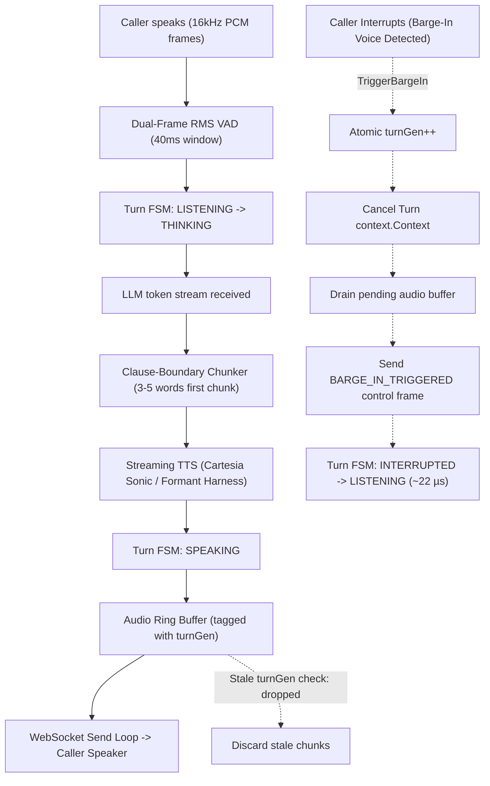

# TurnOrchestrator

[](https://github.com/yoohooshantanu/vocalflow/actions/workflows/ci.yml)
[](https://go.dev/)
[](https://tools.ietf.org/html/rfc6455)
[](https://en.wikipedia.org/wiki/Pulse-code_modulation)

A full-duplex conversational voice turn orchestrator and barge-in coordinator written in Go. It manages the real-time interaction loop between a human caller and voice AI: streaming bi-directional 16kHz PCM audio over WebSockets, detecting interruptions via energy VAD in ~22 µs, cancelling speech playback with zero stale-frame leaks via atomic turn generations, and chunking LLM responses at clause boundaries for sub-250ms time-to-first-audio.

I wanted to build the conversational glue that makes voice AI feel like a real phone call instead of a walkie-talkie: the part where human and machine talk back and forth, interrupt each other, and recover without audio glitching or hanging.

*(The GitHub repo is called vocalflow. The Go module and binary are named turn-orchestrator from a later rename.)*

## Contents

- [The idea in two minutes](#the-idea-in-two-minutes)
- [What is real and what is mocked](#what-is-real-and-what-is-mocked)
- [Turn lifecycle & barge-in flow](#turn-lifecycle--barge-in-flow)
- [The pieces, one by one](#the-pieces-one-by-one)
- [Protocol & audio format](#protocol--audio-format)
- [Run it](#run-it)
- [Observability](#observability)
- [Tests](#tests)
- [Performance](#performance)
- [Limitations and rough edges](#limitations-and-rough-edges)
- [Repo map](#repo-map)
- [Author](#author)

---

## The idea in two minutes

Most voice AI demos feel like talking through a walkie-talkie: you speak, wait through two seconds of silence while the LLM generates a full response, and then listen to a robotic monologue. If you say "Wait, hold on!" while the machine is speaking, it keeps droning on because it cannot hear you while talking.

A natural telephone conversation requires three things to work concurrently:
1. **Low Time-to-First-Audio (TTFA)**: You cannot wait for the LLM to finish generating 50 words. You must stream tokens as they arrive, split them on natural clause boundaries (commas, semicolons, short phrases), and dispatch the first 3–5 words to the TTS synthesizer immediately (<250ms).
2. **Sub-millisecond barge-in detection**: As soon as the caller interrupts, the engine must abort the current turn, cancel active speech synthesis, flush speaker playback queues, and flip the turn state machine back to `LISTENING`.
3. **Turn-generation race elimination**: When Turn 3 is cancelled and Turn 4 starts, any buffered audio frame from Turn 3 still lingering in a channel or goroutine must never leak out to the caller's ears.

This repo implements that entire conversational loop over full-duplex WebSockets using raw 16kHz 16-bit linear PCM audio.

---

## What is real and what is mocked

| Real | Mocked or simplified |
| :--- | :--- |
| **Full-duplex WebSocket streaming**: Raw 16kHz 16-bit mono PCM binary frames over `/ws/voice/{session_id}`. | **Speech-to-Text (ASR)**: Ingested audio runs through real-time energy VAD for barge-in detection, but speech transcription tokens are injected via control messages or mock generators. |
| **Turn-taking FSM**: Strict state transitions (`IDLE` $\rightarrow$ `LISTENING` $\rightarrow$ `THINKING` $\rightarrow$ `SPEAKING` $\rightarrow$ `DRAINING` $\rightarrow$ `INTERRUPTED`). | **LLM generation**: In tests and local demos, streaming token responses are simulated to demonstrate clause chunking and TTFA pipelining without paying LLM token costs. |
| **Atomic turn generations**: Stale audio barrier (`turnGen uint64`) prevents interrupted frames from ever reaching the client player. | **Offline acoustic fallback synthesizer**: `FormantTestHarnessTTS` synthesizes real 16kHz PCM audio ($F_0=150\text{Hz}, F_1=500\text{Hz}, F_2=1500\text{Hz}$) with acoustic energy so CI runs completely offline without cloud API keys. |
| **Clause-boundary sentence chunker**: Splits tokens on punctuation (`,`, `;`, `:`) with heuristic protection for honorifics (`Dr.`, `Mr.`), decimals (`3.14`), and ellipses. | |
| **Dual-window energy VAD**: Physical 40ms accumulation window (two 20ms frames above RMS energy `0.02`) to ignore transient clicks and background pops. | |
| **Production Cartesia Sonic adapter**: Live streaming WebSocket client (`wss://api.cartesia.ai/tts/websocket`) supporting sub-150ms neural speech synthesis. | |
| **Session recovery grace period**: 60-second detached grace window preserves conversation state across telephone network reconnects. | |
| **Fail-closed authentication**: RFC 6454 origin check, Bearer token validation, explicit rejection of query-string tokens. | |
| **27 tests in CI**: Unit, security, and concurrency tests run with `-race` in GitHub Actions. | |

*Summary: This is a real-time conversational streaming and state coordination engine, not an LLM or STT host.*

---

## Turn lifecycle & barge-in flow



---

## The pieces, one by one

### 1. Atomic turn generations (`turnGen uint64`)
When an interruption occurs, aborting the active context is not enough: a goroutine synthesizing speech or reading from a channel might still have audio chunks in flight. 
TurnOrchestrator tags every audio chunk with the current `turnGen`. When barge-in fires:
1. `turnGen` is atomically incremented via `atomic.AddUint64`.
2. The active turn's `context.Context` is cancelled.
3. The pending audio playback buffer is drained.
4. When any chunk reaches the WebSocket sender loop, its `chunk.TurnGen` is compared to the active `turnGen`. If it is older, it is discarded on the spot.

### 2. Clause-boundary sentence chunker
Waiting for a full sentence or entire LLM response creates an unbearable 1.5–3 second delay. 
The clause chunker buffers streaming tokens and emits synthesis chunks based on conversational heuristics:
- **First chunk optimization**: Emits as soon as 3–5 words accumulate and hit a clause boundary (`,`, `;`, `:`, `.`) to achieve sub-250ms Time-to-First-Audio.
- **Abbreviation & number protection**: Skips honorific abbreviations (`Dr.`, `Mr.`, `Ms.`, `Prof.`, `vs.`, `etc.`), decimal values (`3.14`), and ellipses (`...`) so titles and prices do not trigger false sentence splits.

### 3. Dual-window RMS energy VAD
Ingested audio arrives in 20ms frames (640 bytes for 16kHz 16-bit linear PCM). 
The in-process Voice Activity Detector calculates Root Mean Square energy:
$$RMS = \sqrt{\frac{1}{N}\sum_{i=1}^N x_i^2}$$
To prevent transient mouth clicks, breath pops, or line static from triggering false barge-ins, the VAD enforces `BargeInMinFrames: 2`. Two consecutive 20ms frames (>40ms total) must exceed the energy threshold (`0.02`) before the engine confirms caller speech.

### 4. Streaming TTS: Cartesia Sonic & Formant test harness
TurnOrchestrator isolates synthesis behind a clean `StreamingTTSProvider` interface:
- **`CartesiaStreamingTTS`**: Connects via WebSocket to `wss://api.cartesia.ai/tts/websocket`, streaming raw linear PCM frames as speech is generated.
- **`FormantTestHarnessTTS`**: An offline acoustic waveform synthesizer that generates multi-formant audio ($F_0=150\text{Hz}, F_1=500\text{Hz}, F_2=1500\text{Hz}$) with real acoustic energy. Used automatically in CI and local dev when `CARTESIA_API_KEY` is omitted.

### 5. Session reconnect & recovery grace period
Telephone calls over cellular or WebRTC frequently suffer transient network drops. 
When a WebSocket disconnects, TurnOrchestrator does not destroy the dialogue session immediately:
- The session is marked detached and granted a **60-second recovery grace window** (`ShouldExpire`).
- If the carrier or client reconnects to `/ws/voice/{session_id}` within 60 seconds, the audio queue and conversation state reattach seamlessly.

### 6. Fail-closed security & authentication
- **Origin verification**: RFC 6454 origin checking blocks Cross-Site WebSocket Hijacking (CSWSH).
- **Bearer auth**: Constant-time token comparison (`subtle.ConstantTimeCompare`) prevents timing attacks.
- **No query-string tokens**: Tokens passed via query parameters (`?token=...`) are rejected to avoid leaking credentials into web server logs, proxy access trails, and browser history.
- **Production fail-closed**: When `REQUIRE_AUTH=true`, omitting `AUTH_TOKEN` causes the server to refuse startup rather than running unprotected.

---

## Protocol & audio format

### WebSocket endpoint
`GET /ws/voice/{session_id}`

### Audio frames (binary messages)
- **Format**: Raw 16-bit Linear PCM (`pcm_s16le`), mono, 16,000 Hz sample rate.
- **Frame duration**: 20ms per packet (640 bytes per frame).

### Control messages (text JSON messages)
The WebSocket multiplexes binary audio with JSON control frames:

```json
// Triggered by the server when caller speaks during AI playback
{
  "event": "BARGE_IN_TRIGGERED",
  "turn_gen": 4,
  "timestamp_ms": 1700000000123
}
```

```json
// Dispatched when the AI completes a speaking turn
{
  "event": "SPEAKING_COMPLETED",
  "turn_gen": 4,
  "sentences_spoken": 2
}
```

---

## Run it

### Environment variables

| Variable | Default | Description |
| :--- | :--- | :--- |
| `PORT` | `8085` | HTTP & WebSocket listen port |
| `TTS_PROVIDER` | `formant` | Active TTS provider (`cartesia` or `formant`) |
| `CARTESIA_API_KEY` | `""` | Cartesia Sonic API key (omitting uses formant test harness) |
| `CARTESIA_VOICE_ID` | `a0e998e3-182d-4d96-8d1a-0e624b66ffc2` | Cartesia voice identifier |
| `REQUIRE_AUTH` | `false` | When `true`, enforces fail-closed Bearer authentication |
| `AUTH_TOKEN` | `""` | Secret Bearer token required for all requests |

### Running locally

```bash
# Clone the repository
git clone https://github.com/yoohooshantanu/vocalflow.git
cd vocalflow

# Run all tests
go test -v ./tests/...

# Start server
go run ./cmd/server
```

### Running with Docker Compose

```bash
docker compose up -d
```

- **Gateway**: `http://localhost:8085` (WebSocket: `ws://localhost:8085/ws/voice/{session_id}`)
- **Metrics**: `http://localhost:8085/metrics`
- **Prometheus UI**: `http://localhost:9090`
- **pprof Profiling**: `http://localhost:8085/debug/pprof/`

### Creating a session

```bash
curl -X POST http://localhost:8085/v1/sessions \
  -H "Content-Type: application/json" \
  -d '{"client_id": "test_caller_01"}'
```

---

## Observability

TurnOrchestrator exposes Prometheus metrics at `GET /metrics`:

| Metric | Type | Description |
| :--- | :--- | :--- |
| `voice_turn_latency_seconds` | Histogram | Time-to-First-Audio (TTFA) and turn completion latencies |
| `voice_turn_barge_in_total` | Counter | Total caller interruption events triggered |
| `voice_turn_barge_in_reaction_ms` | Gauge | Most recent barge-in reaction latency in milliseconds |
| `voice_active_sessions` | Gauge | Currently connected live voice sessions |
| `voice_audio_frames_total` | Counter | Audio frames processed, labeled by direction (`inbound`, `outbound`) |
| `voice_sentences_synthesized_total`| Counter | Sentence chunks dispatched to TTS synthesis |

Liveness and health checks are available at `GET /healthz`.

---

## Tests

The test suite runs with Go's race detector against live audio buffers, concurrent turn generation transitions, and synthetic WebSocket streams.

| Test File | Focus | Test Count |
| :--- | :--- | :--- |
| `tests/turn_test.go` | FSM transitions, barge-in cancellation, VAD accumulation, clause chunker edge cases | 16 tests |
| `tests/websocket_test.go` | Full-duplex WebSocket streaming, session reconnect grace, fail-closed auth, origin security | 6 tests |
| `tests/benchmark_test.go` | Benchstat microbenchmarks for barge-in latency, RMS calculation, and sentence chunking | 5 benchmarks |

Run all tests:
```bash
go test -v -race ./tests/...
```

---

## Performance

Measured using `benchstat` over 10 independent runs (`-count=10`) on AMD Ryzen 5 (Windows amd64 / Ubuntu x86_64, Go 1.24). Setup overhead (`NewVoiceSession`, FSM creation, channel pre-buffering) is isolated and excluded from the timed interruption regions via `b.StopTimer()`:

```text
Benchmark                                 Time (sec/op)      Memory (B/op)   Allocs (allocs/op)
-----------------------------------------------------------------------------------------------
SpeakingTurnSetupAlone-8                  204.5µs ± 10%         16.33 KiB        54.00 ± 0%
BargeInCancellationLatency-8               22.34µs ± 20%           224 B          9.00 ± 0%
TriggerBargeInDirect-8                     24.07µs ± 12%           224 B          9.00 ± 0%
EndToEndBargeInPipeline-8                  41.46µs ± 32%           295 B         14.00 ± 0%
RMSEnergyCalculation-8                      7.77µs ± 84%             0 B          0.00 ± 0%
SentenceChunker-8                          36.70µs ± 86%           672 B         17.00 ± 0%
```

### Understanding the latencies
- **Pure in-process interrupt (`TriggerBargeInDirect` ~24.1 µs)**: Mutex lock, active turn context cancellation, atomic turn generation bump, audio buffer drain, and FSM transition from `SPEAKING` $\rightarrow$ `INTERRUPTED` $\rightarrow$ `LISTENING`.
- **Full pipeline after frames arrive (`EndToEndBargeInPipeline` ~41.5 µs)**: RMS energy calculation on PCM frame $\rightarrow$ dual-frame VAD threshold evaluation $\rightarrow$ barge-in trigger callback $\rightarrow$ context cancellation $\rightarrow$ output drain $\rightarrow$ WebSocket event emission.
- **Physical audio delay**: The physical accumulation window requires 2 frames $\times$ 20ms = 40ms of voiced audio before confirmation. The engine reacts in **~41.5 µs** once that physical threshold is reached.
- **In-flight boundary guarantee**: When `TriggerBargeIn()` returns, **at most one frame** can already be in flight over the wire. The emitted `BARGE_IN_TRIGGERED` control event signals the client player to flush its local hardware buffer.

---

## Limitations and rough edges

- **No live ASR model**: This engine does not perform speech transcription. It detects energy (voice presence) to handle interruptions and route turns, but delegates speech-to-text to external services.
- **Single-node in-memory sessions**: Active sessions and audio queues live in process memory. If the server crashes mid-call, the caller must reconnect and establish a new session.
- **Fixed PCM audio format**: The engine is strictly hardcoded to 16kHz 16-bit linear mono PCM. It does not transcode Opus, G.711 $\mu$-law, or AAC in-process; an upstream gateway (like `streambridge`) must decode telephony codecs to PCM before feeding this service.
- **VAD is energy-based, not neural**: The VAD uses RMS energy thresholds rather than a neural model (such as Silero VAD). In high-noise environments (e.g. car traffic or barking dogs), energy-based VAD may occasionally trigger false interruptions if the energy threshold is configured too low.

---

## Repo map

| Path | What it does |
| :--- | :--- |
| `cmd/server/main.go` | Gateway entrypoint, route handlers, WebSocket upgrader, graceful shutdown |
| `internal/fsm/fsm.go` | Turn-taking Finite State Machine with thread-safe state transition validation |
| `internal/vad/vad.go` | In-process RMS energy calculation and dual-frame 40ms VAD accumulation |
| `internal/chunker/chunker.go` | Streaming clause-boundary token chunker with honorific and decimal heuristics |
| `internal/pipeline/session.go`| Core voice session, full-duplex loops, atomic turn generations, barge-in coordinator |
| `internal/pipeline/manager.go`| Multi-session registry with 60-second detached reconnect recovery |
| `internal/pipeline/tts.go` | `StreamingTTSProvider` interface, Cartesia Sonic client, and Formant test harness |
| `internal/metrics/metrics.go` | Prometheus metrics definitions and exposition handler |
| `internal/model/types.go` | Audio frame, turn state, and WebSocket control message definitions |
| `tests/turn_test.go` | Turn state transitions, stale audio barriers, and VAD validation |
| `tests/websocket_test.go` | Full-duplex WebSocket tests, session reconnect, and fail-closed security |
| `tests/benchmark_test.go` | Microbenchmarks for barge-in cancellation, RMS energy, and chunking |

---

## Author

- **Shantanu Juvekar** ([@yoohooshantanu](https://github.com/yoohooshantanu))
- Email: `santanujuvekar@gmail.com`
- License: MIT
